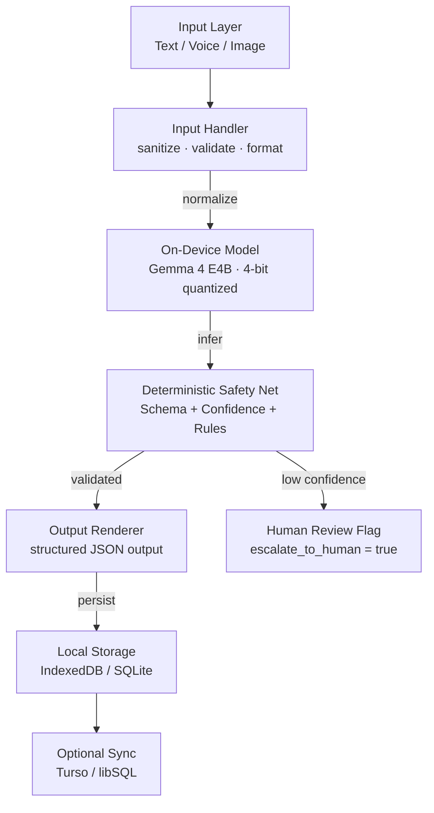

# System Architecture

## Pipeline

## Components

### 1. Input Layer
- **Text input** — symptom description form
- **Voice input** — Vosk offline ASR
- **Image input** — camera capture (wound, rash, lesion)

### 2. Input Handler
- Sanitizes raw user input
- Validates format and completeness
- Normalizes data for the on-device model

### 3. On-Device Inference
- **Model:** Gemma 4 E4B — 4-bit quantized
- **Runtime:** LiteRT-LM v0.18.0 with GPU/NPU acceleration
- **Output:** Structured JSON via constrained decoding
- **Constraint:** Runs fully offline

### 4. Deterministic Safety Net
- **Schema enforcement** — JSON output validated against a fixed schema
- **Confidence threshold** — low-confidence outputs are auto-escalated to human review
- **Rule-based validation** — cross-checked against WHO ETAT+ and SATS clinical protocols
- **Audit trail** — every decision logged locally with input, output, and confidence

### 5. Output Layer
- Triage level (RED / ORANGE / YELLOW / GREEN)
- Suspected condition(s)
- Red flags detected
- Recommended action
- Confidence score
- Auto-generated referral note

### 6. Storage
- **Local-first** — patient records stored on device (IndexedDB / SQLite)
- **Optional sync** — records sync to a clinic dashboard when connectivity returns (Turso / libSQL)

## Constraints

The system is designed to operate **100% offline**. No cloud calls. No external APIs. All inference runs on the device.
